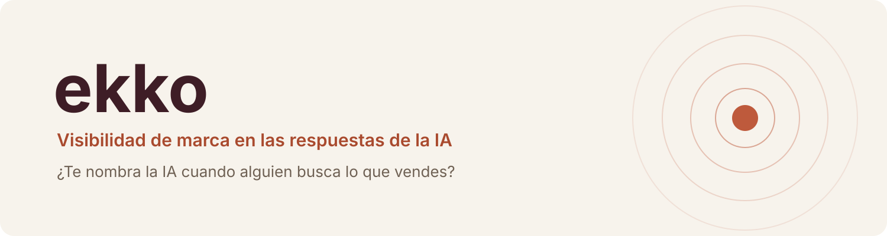
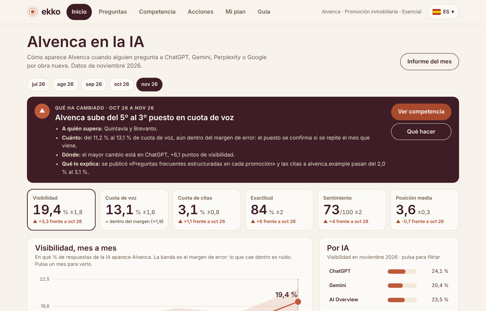
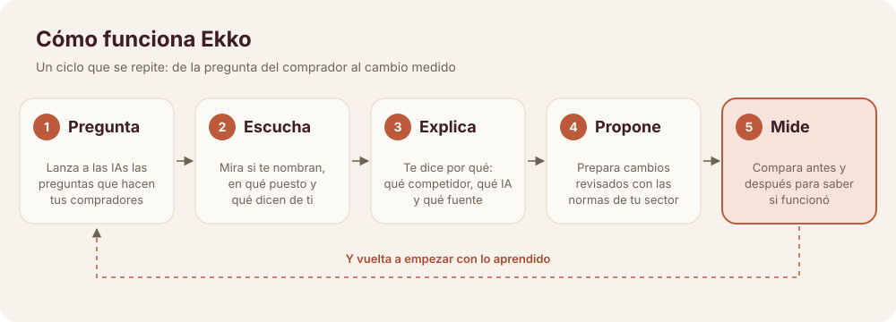
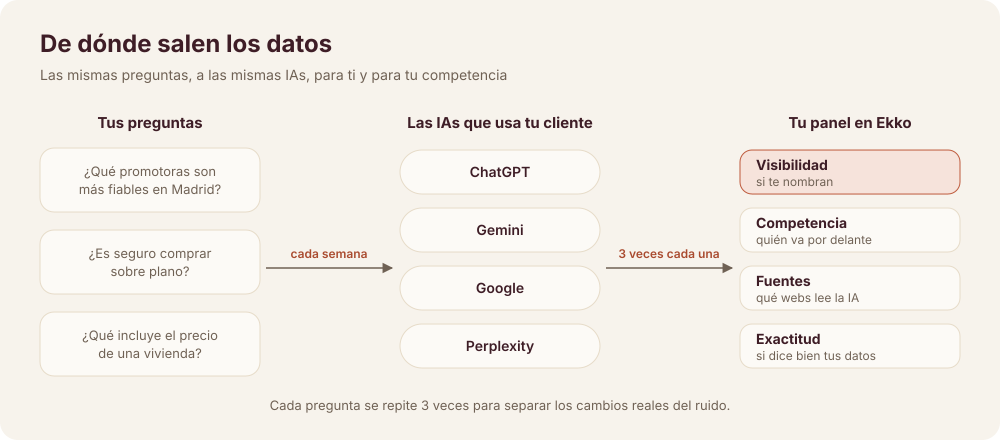
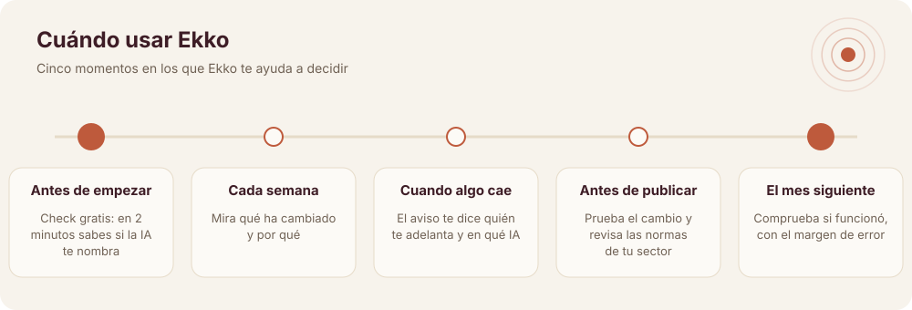
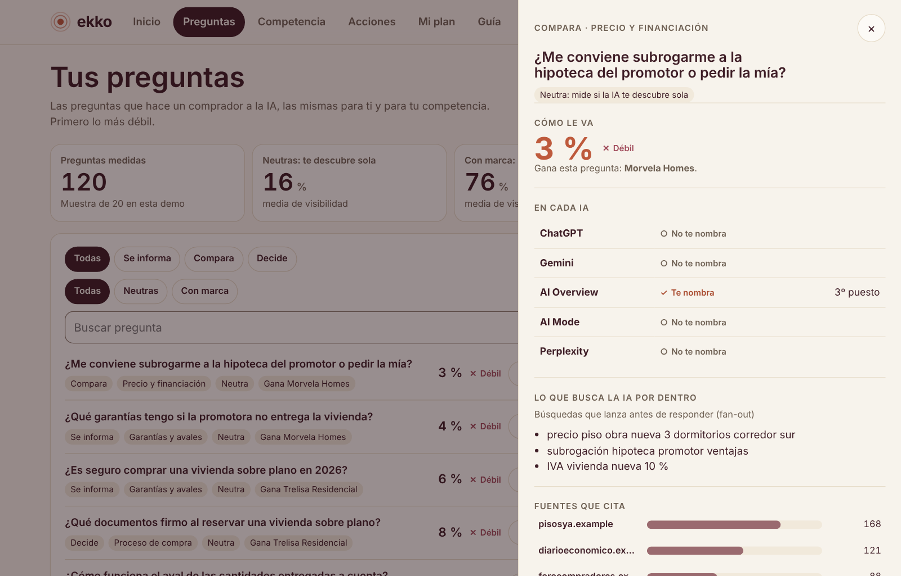
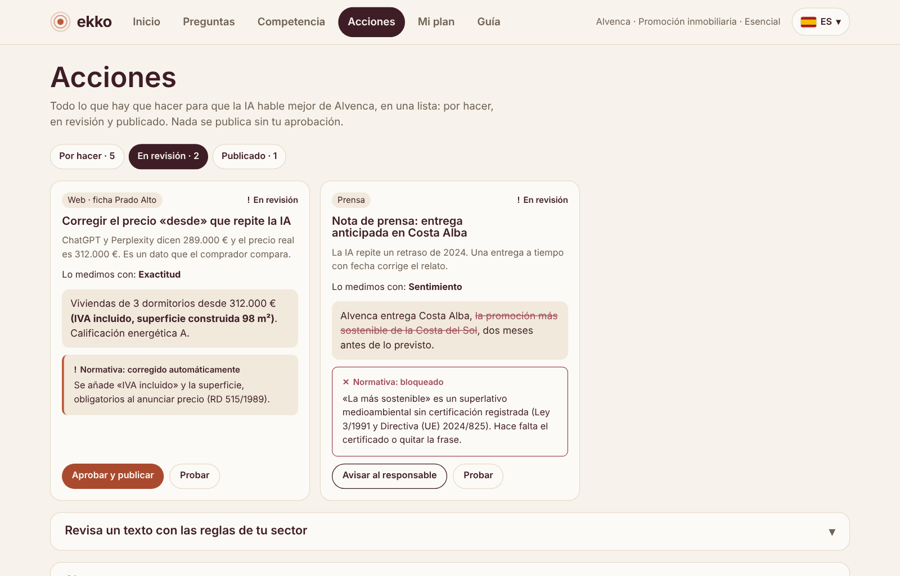
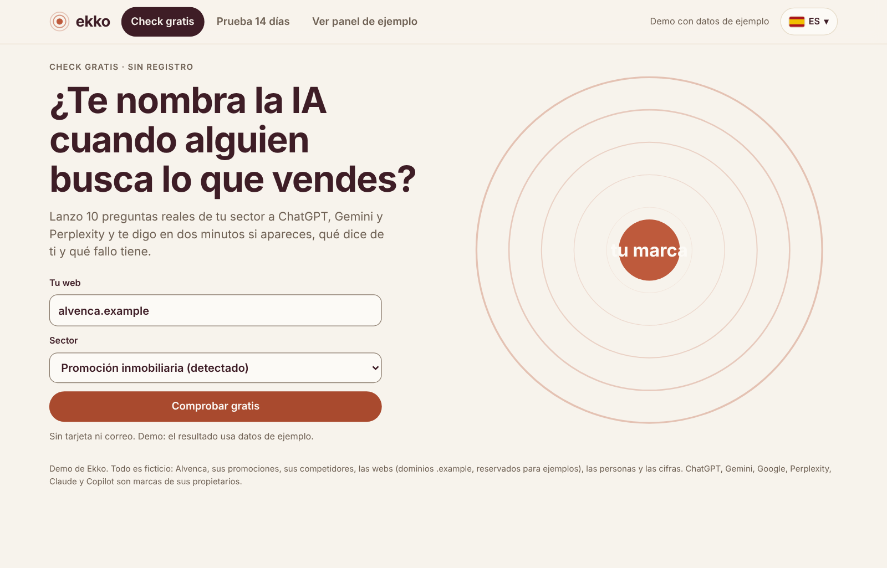
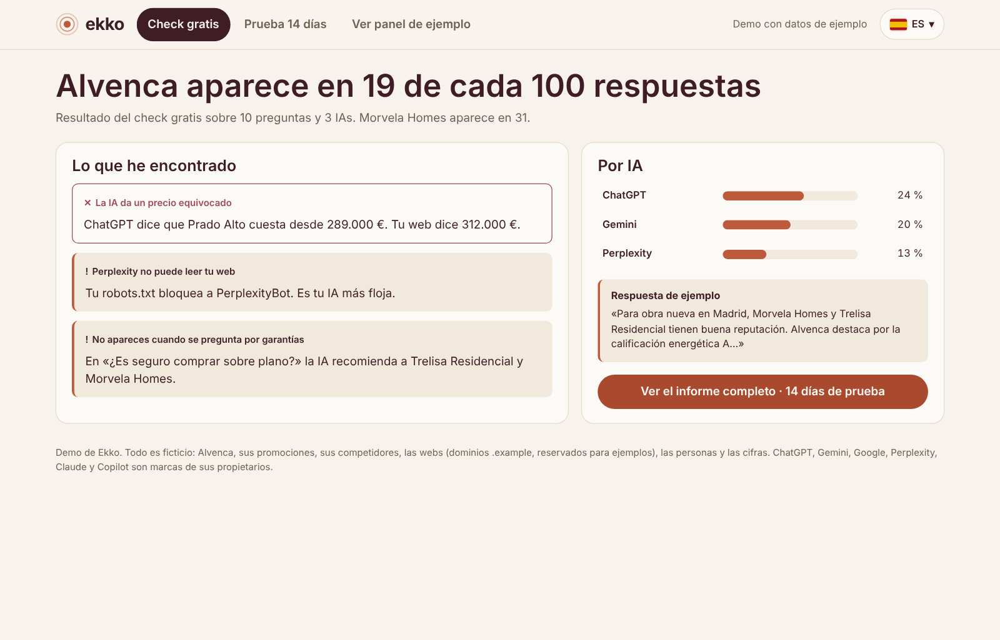

<a href="README.md">English</a> · <b>Español</b>

  

  <a href="https://yael-parra.github.io/GEO-Platform/?lang=es"><b>Prueba la demo interactiva →</b></a>

---

## El cambio

Cada vez más gente se salta el buscador y pregunta a ChatGPT, Gemini, Perplexity o a la IA de Google antes de comprar. «¿Qué promotora es más fiable?», «¿qué colchón me conviene?», «¿qué coche familiar compro?». La IA responde con nombres. Si el tuyo no está, para ese comprador no existes.

**Ekko le dice a una marca si la IA la recomienda, le explica por qué y la ayuda a conseguir que lo haga**, con cada cambio revisado con las normas de su sector y medido después.

> La demo usa una empresa inventada, Alvenca, una promotora de obra nueva. Todo es ficticio: la marca, sus competidores, las webs y las cifras.

## Cómo funciona

1. **Pregunta.** Ekko lanza a las IAs las preguntas que hacen los compradores, desde las generales («¿es seguro comprar sobre plano?») hasta las que nombran a la marca.
2. **Escucha.** Mira si nombran a la marca, en qué puesto, qué dicen de ella y qué webs usa la IA como fuente.
3. **Explica.** Dice por qué: qué competidor se ha adelantado, en qué IA y qué fuente lo explica.
4. **Propone.** Prepara los cambios que conviene hacer en la web o en la comunicación, revisados con las normas del sector.
5. **Mide.** Compara el antes y el después con las mismas preguntas y las mismas IAs, para saber si el cambio funcionó.

## La lógica detrás

Unos pocos principios dan forma a cada pantalla:

- **Tratar a la IA como una encuesta, no como un ranking.** La IA no siempre responde igual, así que Ekko repite cada pregunta varias veces y enseña cada cifra con su margen de error. Una subida que cae dentro de ese margen es ruido, y Ekko lo dice en vez de celebrarla.
- **Una comparación justa.** Las mismas preguntas van a las mismas IAs para la marca y para su competencia.
- **Dos tipos de pregunta.** Las neutras dicen si la IA descubre la marca por sí sola. Las que la nombran dicen qué cuenta de ella.
- **Cada problema lleva a una acción, y cada acción se mide.** Medir no basta; el valor está en cerrar el círculo.
- **El sector marca las reglas.** Una promotora, un laboratorio y una tienda de cosmética no se miden igual ni pueden decir lo mismo.
- **Nada se publica sin aprobación humana.**

## De dónde salen los datos

## Cuándo usarlo

| Momento | Qué te da Ekko |
| --- | --- |
| Antes de empezar | Un check gratis, sin registro: en dos minutos sabes si la IA te nombra y qué fallo tiene |
| Cada semana | Qué ha cambiado y por qué, en una sola pantalla |
| Cuando algo cae | Un aviso que te dice quién te ha adelantado, cuánto y en qué IA |
| Antes de publicar | Una prueba del cambio y una revisión con las normas de tu sector |
| El mes siguiente | El antes y el después de cada cambio, con su margen de error |

## Qué hay dentro

**Inicio.** Las cifras del mes: en cuántas respuestas aparece la marca, qué parte de las menciones son suyas, cuántas veces la IA enlaza su web, si dice bien sus datos y con qué tono habla de ella. Arriba, lo más importante que ha cambiado y su causa.

**Preguntas.** Las preguntas que se miden, de la más débil a la más fuerte. Al abrir una se ve qué IA nombra a la marca, quién gana esa pregunta, qué fuentes lee la IA y qué busca por dentro antes de responder.

**Competencia.** Cómo cambia el puesto de la marca frente a cada competidor mes a mes, en qué IA le va mejor y peor, qué corregir en cada una y qué temas juegan a su favor o en contra.

**Acciones.** Todo lo que conviene hacer, en una sola lista con tres estados: por hacer, en revisión y publicado. Antes de publicar, el texto se revisa con las normas del sector: si se puede corregir, se corrige; si falta un dato que no se puede inventar, se bloquea y se avisa al responsable.

**Mi plan.** Lo que incluye el plan, cuánto se ha consumido este mes y cómo ampliarlo, con aviso al 80 % y sin cobrar más sin confirmación.

## Hecho a medida de cada sector

Al darse de alta, Ekko detecta el sector de la marca y llega configurado con las preguntas típicas de sus compradores en cada fase de la compra, sus competidores habituales, las webs de referencia del sector, las cifras que más importan en él, las normas de contenido que tiene que cumplir y las acciones que suelen funcionar.

## Cómo se empieza

1. **Check gratis.** Escribes una web y en dos minutos sabes si la IA la nombra.
2. **Prueba de 14 días.** Ekko prepara los competidores, las preguntas y las reglas. Tú lo revisas.
3. **Tu panel.** Cada semana, qué ha cambiado y qué hacer.

## Estado

En desarrollo activo. La [demo interactiva](https://yael-parra.github.io/GEO-Platform/?lang=es) enseña la experiencia completa con datos ficticios; en ella, las respuestas de las IAs, la prueba antes de publicar y la revisión de normativa están simuladas, y las reglas de normativa son orientativas. La demo está en español y en inglés, con el menú de idioma de arriba a la derecha.

---

## Sobre mí

  <a href="https://www.linkedin.com/in/yael-parra/">
    
    &nbsp;
    
  </a>

Soy consultora de IA y construyo producto. Trabajo en los dos lados: ayudo a las empresas a adoptar la IA y construyo yo misma las herramientas.

Ekko es mi propio producto. Definí el problema, la lógica por sectores y la experiencia, y diseñé esta demo de principio a fin.

Si trabajas en algo entre la IA y el producto y quieres hablar, me encuentras en [linkedin.com/in/yael-parra](https://www.linkedin.com/in/yael-parra/).

ChatGPT, Gemini, Google, Perplexity, Claude y Copilot son marcas de sus respectivos propietarios. Se citan solo para identificar las IAs que se miden.
