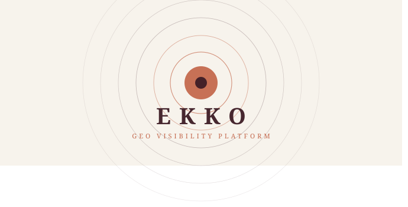

<h1 align="center">EKKO</h1>

  <strong>GEO Visibility Platform &nbsp;·&nbsp; Research Prototype</strong>

  
  
  

---

## The shift nobody is tracking

Every day, millions of people skip the search bar entirely. They ask ChatGPT. They ask Gemini. They ask Perplexity. And those systems answer with recommendations, comparisons, and brand names, built from a logic most companies have never audited.

Your brand is either in that answer or it isn't. And if you don't know which, you're flying blind in the channel that is quietly absorbing intent from traditional search.

That is the problem this platform was built to solve.

---

## What Ekko is

A GEO (Generative Engine Optimization) platform that tracks and improves brand visibility inside LLM-generated responses across ChatGPT, Gemini, Claude, and Perplexity.

Not a monitoring dashboard. A full diagnostic and optimization loop.

**Track.** Query simulation across models, configurable by sector, competitive set, and intent type. You see exactly where your brand appears and where it doesn't.

**Trace.** Every mention mapped back to its source: which model, which indexed URL, which HTML element (H1, H2, metadata, structured data) generated the response. The first platform to do this at the element level, not just the page level.

**Act.** Based on the visibility gap between where you are and where you need to be, the platform surfaces concrete content and metadata changes to test. Not generic SEO advice. Specific interventions, specific pages, specific elements.

**Adapt by sector.** A pharma brand and a beauty retailer don't monitor the same signals or ask the same questions. Ekko autoconfigures the query logic and monitoring layer by industry without manual setup per client.

---

## What this repo contains

The code is private. What's here is the research and product work: the thinking behind the decisions, the competitive landscape, and the business case.

**Competitive analysis.** Direct comparison against Peec AI, Prominence AI, and Profound: positioning, pricing, feature coverage, and where each falls short.

**Unit economics model.** Paid acquisition benchmarks for the martech/SEO category, funnel assumptions across three entry models (freemium, trial without card, trial with card), and full unit economics: CAC, LTV, payback period, LTV/CAC ratio.

**Investor deck.** Problem framing, solution, differentiation, market sizing anchored to real competitor traction data, go-to-market roadmap, and cost structure targeting 87% gross margin.

This is what competitive research and product validation look like before a line of production code is written.

---

## Stack

---

## Status

Research and prototyping phase. The market opportunity is validated. The technical approach is sound. Development is paused while other projects take priority.

The window for first-mover advantage in GEO tooling is narrow. This will not stay a research project indefinitely.

---

## About me

  <a href="https://www.linkedin.com/in/yael-parra/">
    
    &nbsp;
    
  </a>

I'm an AI Consultant and product builder. I work on both sides: advising companies on AI adoption and building the tools myself, from architecture to production deploy.

Ekko is mine. I scoped the market, ran the competitive research, built the unit economics model, wrote the investor deck, and prototyped the platform. Strategy and execution in the same person.

If you're working on something at the intersection of AI and product and want to talk, I'm at [linkedin.com/in/yael-parra](https://www.linkedin.com/in/yael-parra/).

  <a href="https://www.linkedin.com/in/yael-parra/">linkedin.com/in/yael-parra</a>

