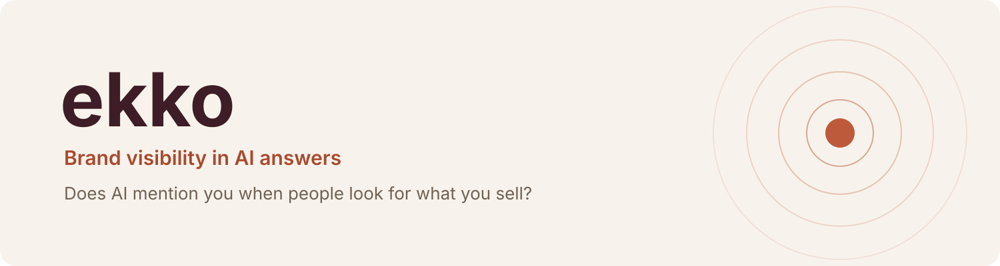
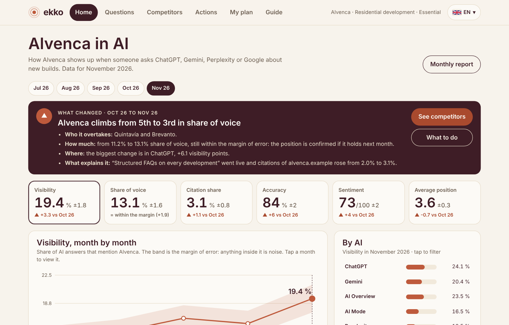
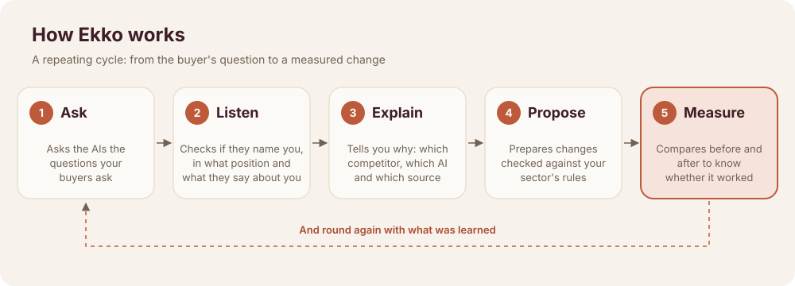
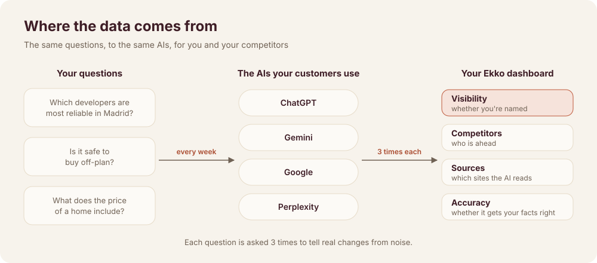
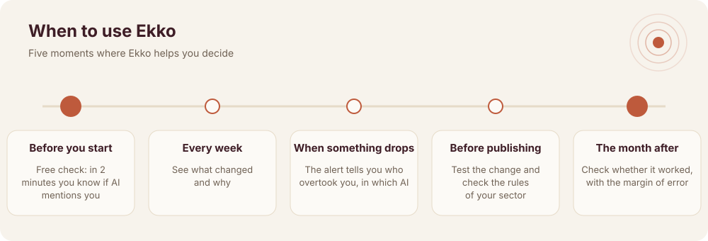
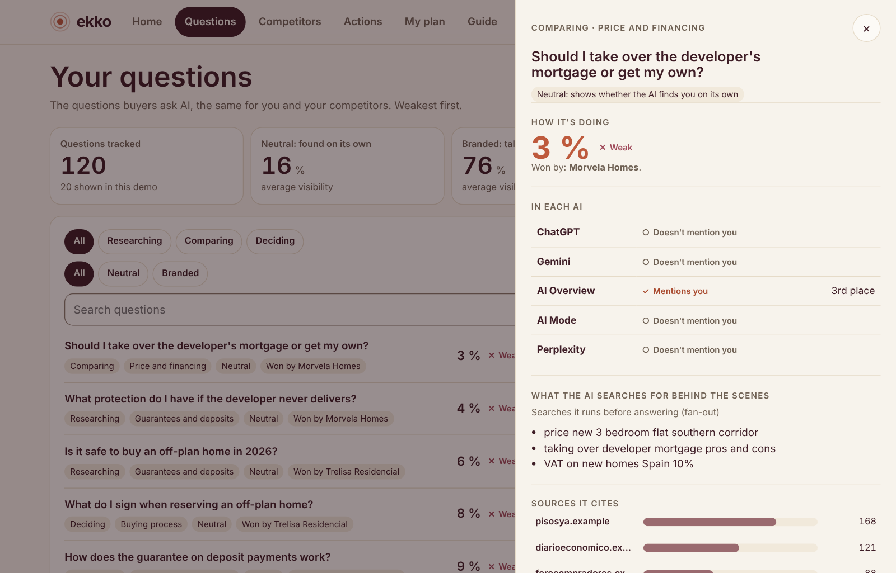
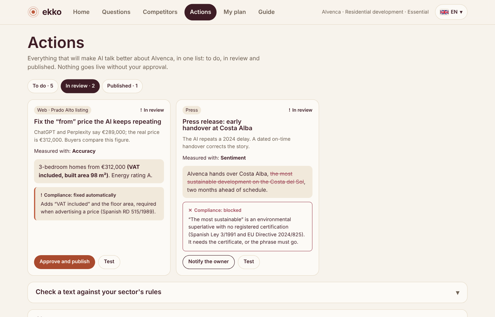
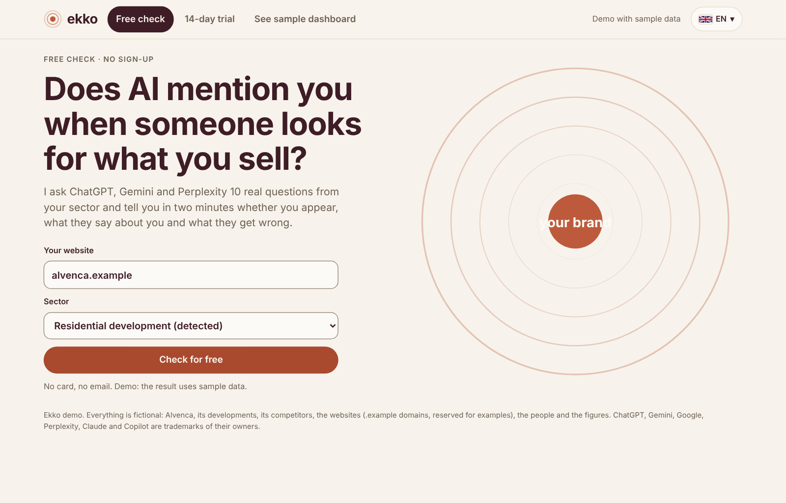
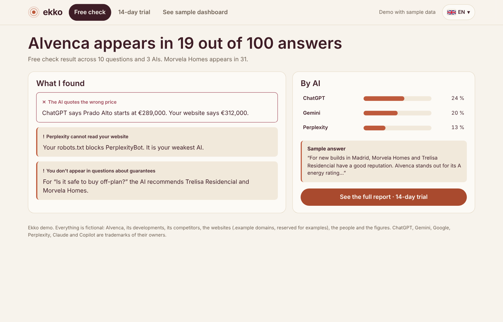

<b>English</b> · <a href="README.es.md">Español</a>

  

  <a href="https://yael-parra.github.io/GEO-Platform/?lang=en"><b>Try the interactive demo →</b></a>

---

## The shift

More and more people skip the search bar and ask ChatGPT, Gemini, Perplexity or Google's AI before they buy. "Which developer is most reliable?", "Which mattress should I get?", "Which family car is best?". The AI answers with names. If yours isn't one of them, for that buyer you don't exist.

**Ekko tells a brand whether AI recommends it, explains why, and helps it get recommended**, with every change checked against the rules of its sector and measured afterwards.

> The demo uses a made-up company, Alvenca, a residential developer. Everything in it is fictional: the brand, its competitors, the websites and the figures.

## How it works

1. **Ask.** Ekko asks the AIs the questions real buyers ask, from general ones ("is it safe to buy off-plan?") to the ones that name the brand.
2. **Listen.** It checks whether the brand is mentioned, in what position, what is said about it and which websites the AI uses as sources.
3. **Explain.** It shows why: which competitor got ahead, in which AI and which source explains it.
4. **Propose.** It prepares the changes worth making on the website or in communications, checked against the sector's rules.
5. **Measure.** It compares before and after with the same questions and the same AIs, to know whether the change worked.

## The thinking behind it

A few principles shape every screen:

- **Treat AI like a poll, not a ranking.** AI doesn't always give the same answer, so Ekko asks each question several times and shows every figure with its margin of error. A rise that falls inside that margin is noise, and Ekko says so instead of celebrating it.
- **A fair comparison.** The same questions go to the same AIs for the brand and for its competitors.
- **Two kinds of question.** Neutral questions show whether the AI discovers the brand on its own. Branded questions show what it says once it's named.
- **Every problem leads to an action, and every action is measured.** Measuring alone is not enough; the value is in closing the loop.
- **The sector sets the rules.** A developer, a pharmaceutical lab and a cosmetics shop are not measured the same way, and they can't say the same things.
- **Nothing goes live without human approval.**

## Where the data comes from

## When to use it

| Moment | What Ekko gives you |
| --- | --- |
| Before you start | A free check with no sign-up: in two minutes you know whether AI mentions you and what it gets wrong |
| Every week | What changed and why, on one screen |
| When something drops | An alert telling you who overtook you, by how much and in which AI |
| Before publishing | A test of the change and a check against your sector's rules |
| The month after | The before and after of each change, with its margin of error |

## What's inside

**Home.** The month's figures: how often the brand appears, its share of all brand mentions, how often the AI links to its website, whether the AI gets its facts right and the tone it uses. At the top, the most important change and its cause.

**Questions.** The questions being tracked, weakest first. Open one to see which AI mentions the brand, who wins that question, which sources the AI reads and what it searches for behind the scenes.

**Competitors.** How the brand's position moves against each competitor month by month, which AI it does best and worst in, what to fix in each one, and which topics play for or against it.

**Actions.** Everything worth doing, in one list with three states: to do, in review and published. Before anything goes live, the text is checked against the sector's rules: if it can be fixed, it is fixed; if a fact is missing that can't be made up, it is blocked and the owner is notified.

**My plan.** What the plan includes, how much has been used this month and how to upgrade, with a warning at 80% and no extra charge without confirmation.

## Built for each sector

When a brand signs up, Ekko detects its sector and arrives configured with the typical buyer questions for each stage of the purchase, the usual competitors, the reference websites for that sector, the metrics that matter most there, the content rules it has to follow and the actions that tend to work.

## Getting started

1. **Free check.** Enter a website and find out in two minutes whether AI mentions it.
2. **14-day trial.** Ekko sets up the competitors, questions and rules. You review them.
3. **Your dashboard.** Every week, what changed and what to do.

## Status

In active development. The [interactive demo](https://yael-parra.github.io/GEO-Platform/?lang=en) shows the full experience with fictional data; in it, the AI answers, the test before publishing and the compliance check are simulated, and the compliance rules are indicative. The demo is available in English and Spanish from the language menu in the top right corner.

---

## About me

  <a href="https://www.linkedin.com/in/yael-parra/">
    
    &nbsp;
    
  </a>

I'm an AI consultant and product builder. I work on both sides: helping companies adopt AI and building the tools myself.

Ekko is my own product. I defined the problem, the sector logic and the experience, and designed this demo end to end.

If you're working on something at the intersection of AI and product and want to talk, find me at [linkedin.com/in/yael-parra](https://www.linkedin.com/in/yael-parra/).

ChatGPT, Gemini, Google, Perplexity, Claude and Copilot are trademarks of their respective owners, named only to identify the AIs being measured.
